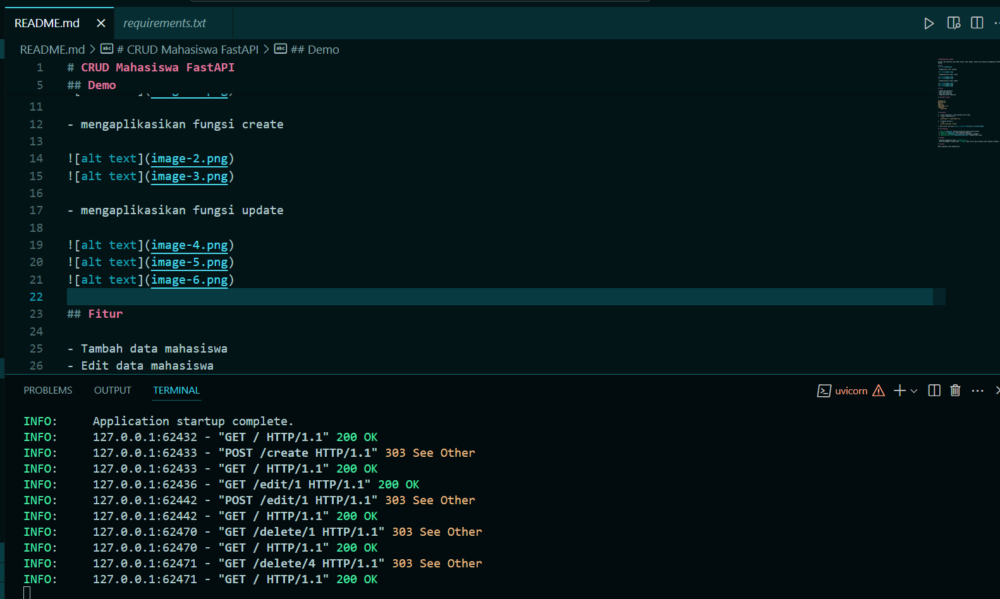
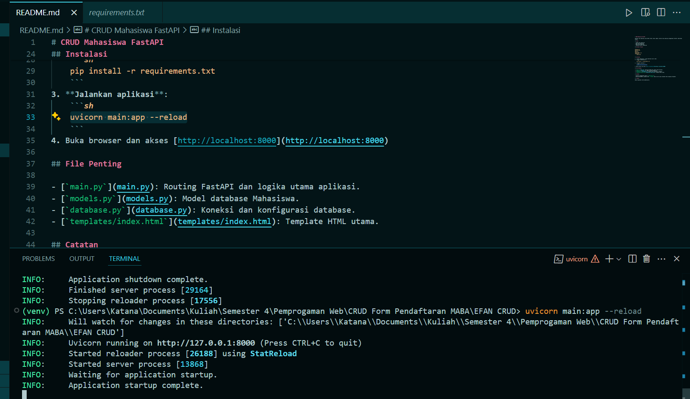
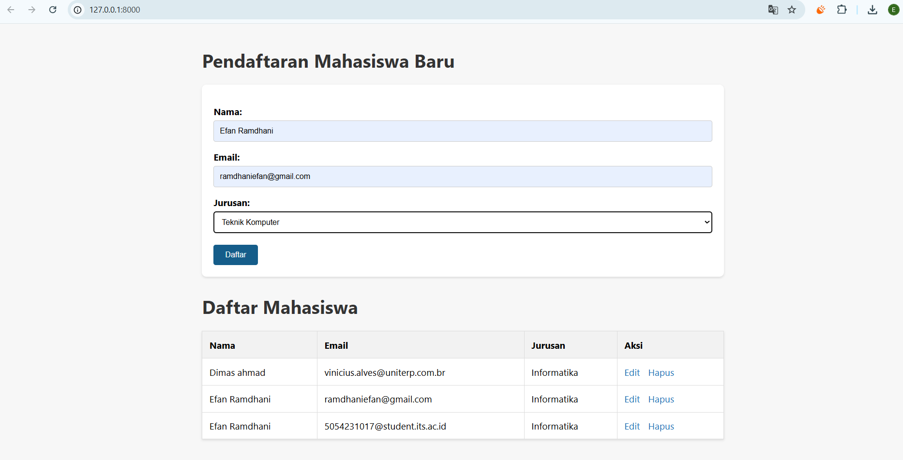
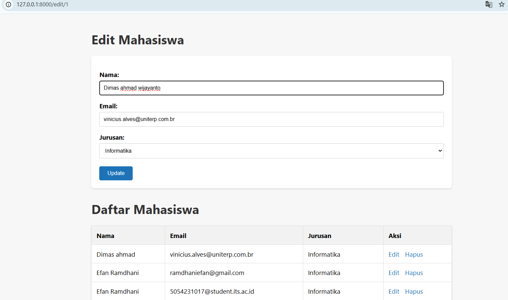
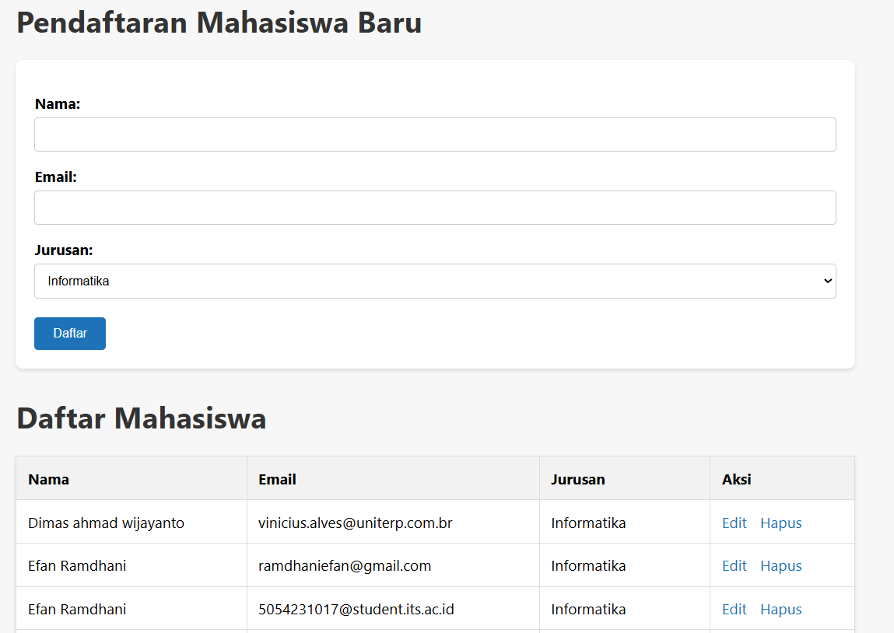
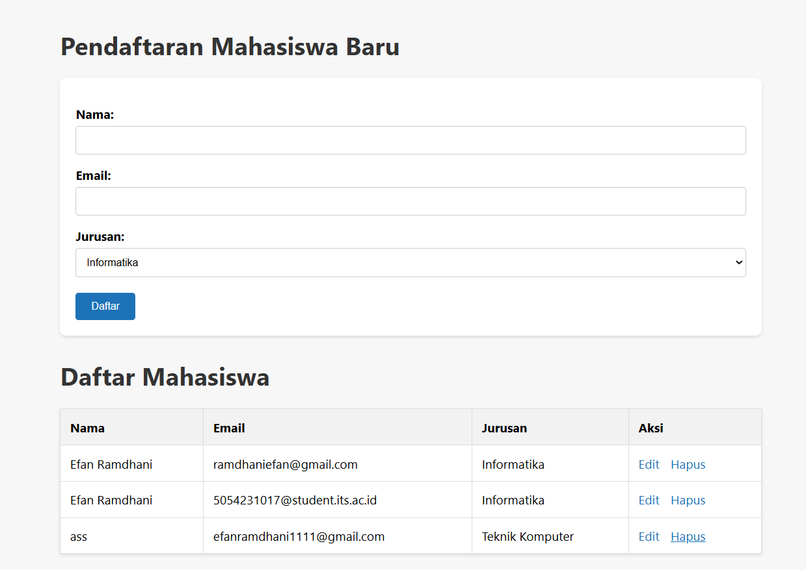
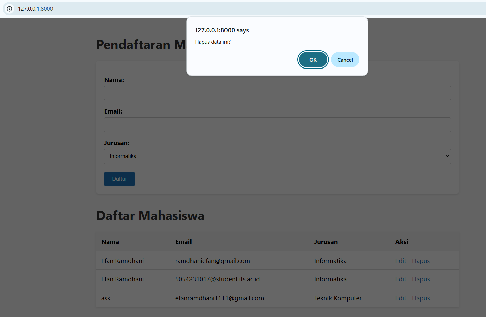
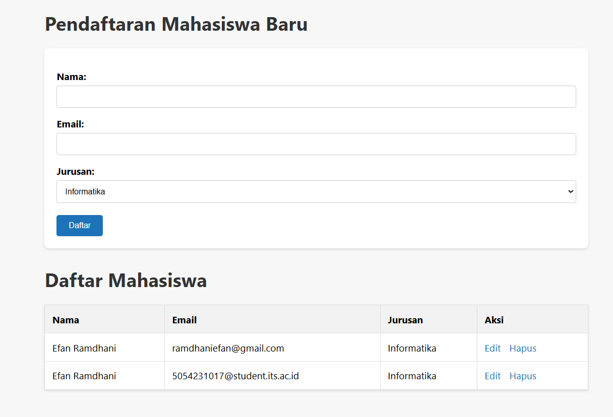

# CRUD Mahasiswa FastAPI

Aplikasi web sederhana untuk CRUD (Create, Read, Update, Delete) data mahasiswa menggunakan FastAPI, SQLAlchemy, dan Jinja2.


## Demo


- Mengaktifkan server backend



- mengaplikasikan fungsi create




- mengaplikasikan fungsi update





## Fitur

- Tambah data mahasiswa
- Edit data mahasiswa
- Hapus data mahasiswa
- Tampilkan daftar mahasiswa

## Struktur Project

```
database.py
mahasiswa.db
main.py
models.py
requirements.txt
templates/
    index.html
```

## Instalasi

1. **Clone repository** (atau download source code).
2. **Install dependencies**:
    ```sh
    pip install -r requirements.txt
    ```
3. **Jalankan aplikasi**:
    ```sh
    uvicorn main:app --reload
    ```
4. Buka browser dan akses [http://localhost:8000](http://localhost:8000)

## File Penting

- [`main.py`](main.py): Routing FastAPI dan logika utama aplikasi.
- [`models.py`](models.py): Model database Mahasiswa.
- [`database.py`](database.py): Koneksi dan konfigurasi database.
- [`templates/index.html`](templates/index.html): Template HTML utama.

## Catatan

- Database menggunakan SQLite (`mahasiswa.db`).
- Untuk development, gunakan mode `--reload` pada uvicorn agar perubahan kode langsung terupdate.

## Lisensi

Bebas digunakan untuk pembelajaran.